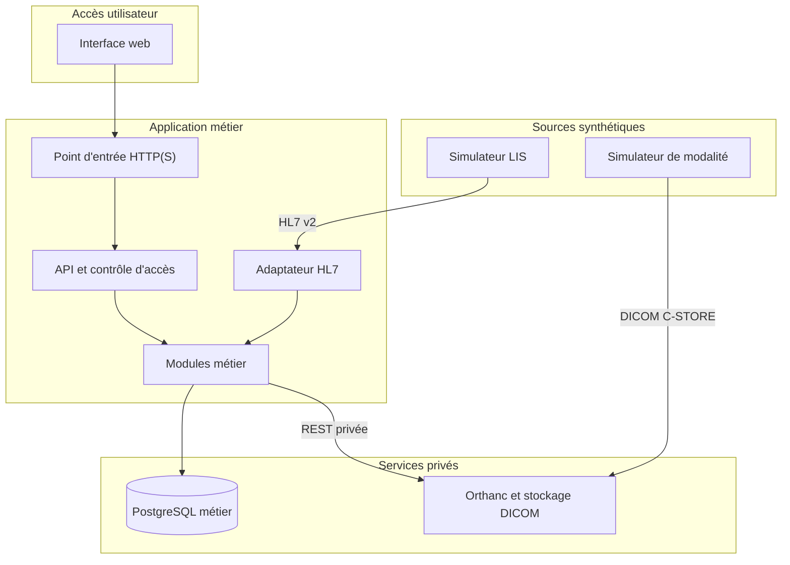
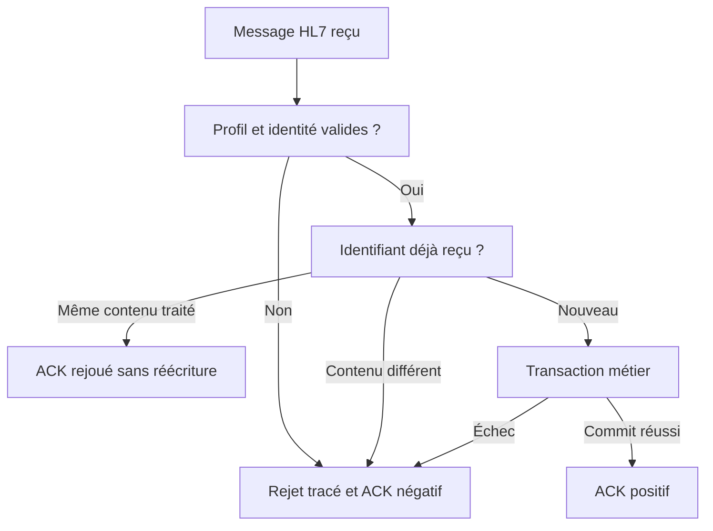

# Architecture du projet

## 1. Choix directeur

Le projet est organisé en **monorepo avec backend modulaire** : une seule application métier, découpée par responsabilités, et un service Orthanc indépendant pour l'imagerie.

Ce choix permet de distribuer les tâches sans imposer dès le départ des microservices, un bus de messages ou plusieurs bases métier. Un module est une frontière de code et de responsabilité, pas nécessairement un processus déployé séparément.

La base de conception provient des six documents existants. FastAPI, PostgreSQL, Orthanc et les échanges HL7/DICOM prolongent cette conception. Les précisions nouvelles du squelette, notamment les contrats de réponse et le découpage des lots, sont des propositions explicites dans [les décisions](docs/DECISIONS.md).

## 2. Vue des composants

Le proxy désigne le point d'entrée futur. Un composant dédié est utile pour HTTPS et les règles d'exposition, mais n'est pas livré dans ce squelette.

## 3. Responsabilités internes

| Module | Responsabilité exclusive | Ne doit pas prendre en charge |
|---|---|---|
| `identity` | Patient, identifiants, rencontres et recherche | Résultats biologiques ou stockage DICOM |
| `auth` | Authentification, rôles, permissions et contexte d'accès | Décisions cliniques |
| `laboratory` | Demandes biologiques, rapports versionnés, observations et données manquantes | Décodage réseau HL7 |
| `radiology` | Demandes, examens, états RIS et comptes rendus | Stockage des pixels |
| `imaging` | Références d'études, rapprochement, disponibilité et accès aux images | Administration de comptes Orthanc |
| `summary` | Composition du dossier de consultation | Écriture directe dans les tables des autres modules |
| `audit` | Événements d'accès, refus et modifications | Copies de résultats, mots de passe ou messages HL7 complets |
| `integrations/hl7` | Réception, parsing, validation de profil et acquittements | Logique métier parallèle au laboratoire |
| `integrations/orthanc` | Appels Orthanc, délais, traduction des erreurs | Autorisation clinique finale |

Les adaptateurs transforment les données externes en commandes métier. Les services métier portent les règles. Les repositories portent les accès à la base. Les routes HTTP restent minces.

## 4. Organisation du backend

La structure suivante est une convention à implémenter dans chaque domaine utile :

| Fichier prévu | Rôle |
|---|---|
| `router.py` | Routes et dépendances d'authentification |
| `schemas.py` | Données d'entrée et de sortie |
| `services.py` | Cas d'utilisation et règles métier |
| `repository.py` | Requêtes et écritures persistantes |
| `models.py` | Modèles persistants du domaine |
| `tests/` | Tests unitaires du domaine |

Il n'est pas nécessaire de créer cinq fichiers vides par module dès le premier jour. Les README présents fixent les frontières. Le code apparaît avec la première fonctionnalité testée.

Règles de dépendance :

- `core` ne dépend d'aucun module métier ;
- une route appelle un service, jamais Orthanc directement ;
- `summary` appelle les services de lecture des autres domaines ;
- un domaine ne modifie pas directement les tables appartenant à un autre ;
- les échanges entre domaines utilisent des identifiants UUID et des objets documentés ;
- l'adaptateur HL7 réutilise les mêmes services que l'API, sans second modèle de données.

Un listener MLLP pourra être lancé comme processus séparé à partir du même backend. Cela ne transforme pas le projet en architecture microservices.

## 5. Flux principaux

### 5.1 Identité et préparation

Un jeu de données synthétique crée un patient, une rencontre et les identifiants d'examens attendus. Les simulateurs utilisent exactement ces identifiants. Aucun rapprochement par nom approximatif n'est admis.

L'identité externe est le couple `identifier_domain + external_id`. L'UUID interne sert aux relations de la base. Le fichier [scenario.json](data/fixtures/scenario.json) fixe les valeurs de démonstration.

### 5.2 Laboratoire

Le premier périmètre teste l'ingestion d'une demande `OML^O21`, puis d'un résultat `ORU^R01` envoyé par un simulateur. C'est un sens d'échange de démonstration, pas une description universelle de tous les LIS.

Le profil local HL7 doit être fixé avant le codage. Les champs et segments réellement acceptés seront testés sur des fixtures. Le simple fait de reconnaître le type du message ne prouve pas sa conformité.

Une CRP attendue mais absente produit une observation `data_status: missing`, sans valeur numérique. Les autres résultats restent exploitables. Une correction produit une nouvelle version du rapport.

### 5.3 Radiologie et imagerie

1. Le module RIS porte la demande et son numéro d'accession.
2. Une modalité simulée envoie une étude DICOM à Orthanc par C-STORE.
3. Le connecteur lit les métadonnées utiles via l'API REST privée Orthanc.
4. Le module imagerie vérifie le patient, l'accession et le Study Instance UID.
5. L'étude est rattachée à l'examen, puis devient consultable selon les droits.

Une étude non rapprochée reste en attente de traitement ; elle n'est jamais affectée au premier patient portant le même nom. Les nombres de séries et d'instances ne suffisent pas, seuls, à prouver que l'étude est complète.

L'API REST Orthanc n'est pas DICOMweb. QIDO-RS, WADO-RS et STOW-RS sont une extension ultérieure si le viewer retenu l'exige. L'installation de plugins et leurs versions devra alors être explicite.

### 5.4 Consultation

Le navigateur demande `GET /api/v1/encounters/{id}/summary`. Le backend vérifie le contexte d'accès, lit les données métier, ajoute l'état d'imagerie et journalise la consultation.

Le résultat regroupe :

- l'identité minimale et la rencontre ;
- les rapports biologiques avec leurs états de qualité ;
- les examens et comptes rendus radiologiques ;
- les références d'imagerie et leur disponibilité ;
- une liste d'avertissements structurés.

Les fichiers DICOM ne sont pas inclus dans cette réponse. La consultation d'image passe par un accès applicatif contrôlé. Aucun identifiant technique Orthanc ou secret n'est remis au navigateur.

## 6. Répartition des données

| Système | Données conservées | Source de vérité |
|---|---|---|
| PostgreSQL métier | Patient, rencontre, laboratoire, RIS, références d'études, comptes, audit | État métier du prototype |
| Orthanc | Objets DICOM et index interne du PACS | Fichiers et métadonnées DICOM reçus |
| Frontend | État de navigation et affichage temporaire | Aucune donnée clinique faisant autorité |
| Simulateurs | Jeux synthétiques reproductibles | Entrées de test uniquement |

La base PostgreSQL applicative n'est pas l'index privé d'Orthanc. Il n'y a aucun accès SQL direct aux tables internes d'Orthanc.

Le modèle détaillé et les contraintes sont dans [MODELE_DONNEES.md](docs/MODELE_DONNEES.md).

## 7. Cas dégradés et limites temporelles

| Incident | Comportement attendu |
|---|---|
| CRP absente | Valeur nulle, état `missing`, avertissement local ; autres observations conservées |
| Orthanc indisponible | Dossier retourné en HTTP 200 avec état dégradé ; images non accessibles |
| PostgreSQL indisponible | API métier indisponible, readiness HTTP 503, aucun faux succès |
| HL7 rejoué à l'identique | Pas de nouveau rapport ni observation après un premier traitement réussi |
| Même identifiant HL7, contenu différent | Conflit explicite, aucune modification silencieuse |
| Patient inconnu | Rejet/quarantaine logique, aucune création ou fusion automatique |
| Accès sans droit | HTTP 403 et événement d'audit sans données cliniques |

La disponibilité d'Orthanc ne doit pas déterminer seule la readiness de toute l'application. Une vérification technique séparée signale l'état du PACS.

La cible issue de la conception est une consultation sans pixels en moins d'une seconde au p95 en situation nominale, et un traitement HL7 nominal en moins de deux secondes. Ce sont des objectifs à mesurer, pas des performances obtenues.

Proposition : état d'imagerie mis en cache avec date de dernière synchronisation, délai d'appel court et configurable, aucun retry réseau en boucle dans la consultation. Le budget initial de 500 ms pour Orthanc doit être ajusté sur mesures.

## 8. Sécurité transversale

Les contrôles portent sur l'authentification, les rôles, le contexte du dossier, les données entrantes, les secrets et l'audit. Un rôle seul ne donne pas accès à tous les patients.

PostgreSQL, l'interface d'administration Orthanc et le transport HL7 ne sont pas exposés publiquement. MLLP n'apporte pas à lui seul une protection de transport. Les essais restent sur un réseau local isolé.

La défaillance d'audit avant une opération clinique conduit, par proposition de démarrage, à refuser cette opération. Cette règle doit être testée, pas simplement mentionnée.

Voir [SECURITY.md](SECURITY.md) pour les garde-fous et limites.

## 9. Ce qui est volontairement hors périmètre initial

- Microservices, orchestration Kubernetes et bus d'événements.
- Connexion à un établissement réel et migration de dossiers réels.
- Facturation, prescriptions avancées et gestion exhaustive des prélèvements.
- DICOM Modality Worklist, comptes rendus structurés et viewer diagnostique certifié.
- Reconnaissance automatique d'identité ou interprétation médicale.
- Certification de conformité ou validation de déploiement clinique.

Ces extensions ne doivent pas bloquer le parcours synthétique de bout en bout.

## 10. Premier incrément vérifiable

Le premier jalon n'est pas « tous les dossiers créés ». C'est un parcours minimal démontré : patient synthétique, rencontre, résultat HL7, étude Orthanc, dossier affiché et accès audité. Le même parcours est ensuite rejoué avec CRP manquante et Orthanc arrêté.

Le [backlog](docs/BACKLOG.md) transforme cette architecture en unités de travail indépendantes et testables.

