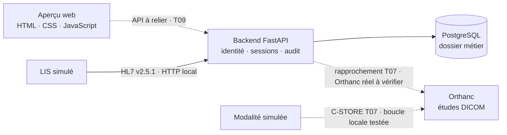

<h1 align="center">🩺 PACS · LIS · RIS</h1>

<p align="center">
  <strong>Un dossier patient unifié, construit avec des données 100 % fictives.</strong><br>
  Mini-projet V · Santé digitale et ingénierie des systèmes de santé · ENSAM Rabat
</p>

<p align="center">
  
  
  <a href="https://github.com/Bouch-Anass/Prototype-de-syst-me-de-gestion-de-donn-es-PACS-LIS-RIS-simplifi-/actions/workflows/check-architecture.yml">
    
  </a>
</p>

<p align="center">
  
  
  
  
  
  
</p>

<p align="center">
  <a href="#aperçu">Aperçu</a> · <a href="#démarrage-rapide">Démarrage rapide</a> ·
  <a href="#architecture">Architecture</a> · <a href="#feuille-de-route">Feuille de route</a> ·
  <a href="#documentation">Documentation</a>
</p>

> [!IMPORTANT]
> Prototype pédagogique pour un établissement fictif. Aucune donnée réelle de patient ni utilisation diagnostique ou clinique.

## Aperçu

Le projet relie **biologie (LIS)**, **radiologie (RIS)** et **imagerie (PACS)** autour d'un patient et d'une rencontre. Le parcours cible part d'une demande, intègre les résultats et les études, puis compose un dossier consultable par un utilisateur autorisé.

La v0.1 se limite à un parcours synthétique pour le médecin, le radiologue, le technicien de laboratoire et l'administrateur. Facturation, pharmacie, portail patient et diagnostic automatisé sont hors périmètre. Les obligations de confidentialité, notamment la loi marocaine 09-08, restent à étudier ; aucune conformité certifiée n'est revendiquée.

| Ce qui se visite ou se teste aujourd'hui | État |
| --- | --- |
| [Aperçu web](frontend/README.md) : dossier synthétique, CRP absente et PACS indisponible | Fonctionne sur trois réponses JSON fictives ; pas encore connecté à l'API |
| [Backend FastAPI](backend/README.md) : session, identité, audit, laboratoire, HL7, RIS et rapprochement Orthanc interne | Implémenté et testé sur SQLite avec un faux Orthanc ; PostgreSQL et Orthanc réel restent à vérifier |
| [Environnement local](infra/README.md) : PostgreSQL et Orthanc dans Docker Compose | Configuration prête ; démarrage et persistance non vérifiés sur ce poste |
| [Contrats](contracts/README.md) HL7 v2.5.1, API et imagerie | Profil HL7 branché au laboratoire ; workflows RIS et rapprochement PACS internes testés |

## Démarrage rapide

**Voir l'interface sans installer de dépendances :** depuis la racine du dépôt, lancez un serveur HTTP local.

```bash
python3 -m http.server 8000 --bind 127.0.0.1
```

Ouvrez **http://127.0.0.1:8000/frontend/** et recherchez `DEMO-P001`. Sous Windows, remplacez `python3` par `py`. L'aperçu utilise les mocks du dépôt ; il ne demande ni PostgreSQL ni Orthanc.

**Essayer le backend T03 :** initialisez les secrets locaux avec `python3 scripts/init_local_env.py`, démarrez les services avec `docker compose -f infra/compose.yaml up -d`, puis suivez le [guide backend](backend/README.md) pour migrer la base, créer un compte et accorder l'accès à la rencontre synthétique. Les services Docker n'ont pas encore été validés sur ce poste.

## Architecture



Les traits pointillés indiquent les intégrations qui restent à valider avec les services Docker et à relier à l'interface. Le flux HL7 local est testé sur SQLite ; PostgreSQL reste à vérifier. Le simulateur DICOM a été testé par C-STORE en boucle locale, et le rapprochement avec un faux Orthanc. Les pixels DICOM restent dans Orthanc dans l'architecture cible ; les données métier et les traces résident dans PostgreSQL. Le navigateur ne reçoit ni accès direct à la base ni identifiants d'administration Orthanc. L'[architecture détaillée](ARCHITECTURE.md) décrit les frontières et les modes dégradés.

### Stack et état réel

| Couche | Technologie | Situation |
| --- | --- | --- |
| API | Python, FastAPI, SQLAlchemy, Alembic | Socle T03, laboratoire T04, HL7 T05 et services internes RIS T06 / imagerie T07 implémentés |
| Données métier | PostgreSQL 17 | Compose préparé ; tests applicatifs actuels sur SQLite |
| PACS | Orthanc | Compose préparé ; client REST interne testé avec doubles ; import réel et viewer à venir |
| Interface | HTML, CSS, JavaScript | Aperçu statique sur mocks |
| Échanges | HL7 v2.5.1, DICOM | HL7 testé sur SQLite ; génération DICOM et C-STORE de boucle locale testés |

## Scénario synthétique

Le [manifeste commun](data/fixtures/scenario.json) suit le patient `DEMO-P001` pendant la rencontre `DEMO-E001` : une CRP, une mesure de glucose et un examen CT. La variante dégradée garde le glucose visible quand la CRP manque ; **une valeur absente n'est jamais transformée en zéro**. Les [trois réponses de référence](contracts/examples/README.md) couvrent le cas nominal, la CRP manquante et l'indisponibilité d'Orthanc.

## Vérifications

Les derniers contrôles documentés ont réussi : **17 tests de contrat**, **38 tests backend sur SQLite**, **1 test DICOM/C-STORE en boucle locale**, contrôle des liens et fichiers du dépôt, et migrations Alembic vérifiées sur une base SQLite temporaire. La connexion PostgreSQL, l'import dans Orthanc Docker, les healthchecks, la persistance et le parcours complet restent à mesurer. Voir les [preuves et limites](docs/VERIFICATIONS.md).

```bash
python3 scripts/check_repo.py
python3 -m unittest discover -s tests/contract -v
# Après installation de backend/requirements-dev.txt :
python3 -m unittest discover -s tests/backend -v
# Après installation de simulators/modality/requirements.txt :
python3 -m unittest discover -s tests/modality -v
```

<details>
<summary>Objectifs de validation du scénario complet</summary>

| Indicateur | Cible initiale | Mesure actuelle |
| --- | --- | --- |
| Temps de réponse du dossier, p95 | Moins de 1 s sur 30 lectures après échauffement | Non mesuré |
| Délai d'intégration HL7 nominal | Moins de 2 s entre réception et persistance | Non mesuré |
| Complétude du dossier | 100 % en nominal ; défaut visible en dégradé | Non mesurée |
| Accès refusés journalisés | 100 % des cas testés | Test T03 ciblé ; scénario global non testé |
| Scénario complet | 5 répétitions réussies sur 5 | Non testé |

</details>

## Feuille de route

- [x] **T01/T02 — préparation :** Compose local, contrats, profil HL7, fixtures et aperçu web.
- [x] **T03 — première tranche :** migration, identité synthétique, sessions, accès par rencontre et audit.
- [ ] **Validation PostgreSQL :** démarrage depuis un clone, migration et persistance des volumes.
- [x] **T04 — service laboratoire :** demandes, résultats, valeurs manquantes, rejeux et corrections testés sur SQLite.
- [x] **T05 — première tranche HL7 :** endpoint interne, profil local, ACK, rejeu et corrections testés sur SQLite.
- [ ] **T05 — validation restante :** rejeux concurrents et parcours PostgreSQL.
- [x] **T06 — première tranche :** service interne RIS, transitions et validation réservée au radiologue testés sur SQLite.
- [ ] **T06 — validation restante :** routes HTTP, concurrence et parcours PostgreSQL.
- [x] **T07 — première tranche :** DICOM synthétique, C-STORE de boucle locale et rapprochement Orthanc interne testés.
- [ ] **T07 — validation restante :** import Orthanc Docker, PostgreSQL et concurrence.
- [ ] **T08–T11 :** synthèse clinique, interface reliée à l'API, viewer contrôlé et parcours intégré.
- [ ] **T12 :** démonstration reproductible et bilan final.

Le [backlog détaillé](docs/BACKLOG.md) donne les critères d'acceptation de chaque étape. Les décisions encore ouvertes sont suivies dans [docs/DECISIONS.md](docs/DECISIONS.md).

## Documentation

| Lire | Pour |
| --- | --- |
| [Guide de démarrage](docs/DEMARRAGE.md) · [Backend](backend/README.md) · [Infrastructure](infra/README.md) | Installer et exécuter les parties disponibles |
| [Architecture](ARCHITECTURE.md) · [Modèle de données](docs/MODELE_DONNEES.md) | Comprendre les composants et les invariants |
| [Contrats API, HL7 et imagerie](contracts/README.md) · [Fixtures](data/README.md) | Développer les domaines sur des exemples communs |
| [Design](DESIGN.md) · [Aperçu frontend](frontend/README.md) | Comprendre et ouvrir l'interface sur mocks |
| [Contribuer](CONTRIBUTING.md) · [Sécurité](SECURITY.md) · [Répartition](docs/REPARTITION_TRAVAIL.md) | Participer sans mélanger les responsabilités |
| [Conception initiale](docs/conception/) · [Vérifications](docs/VERIFICATIONS.md) | Retrouver les six PDF et les preuves d'essai |

<details>
<summary>Historique du projet</summary>

| Jalon | Livrables | État |
| --- | --- | --- |
| Semaine 1 | Six PDF : cadrage, besoins, étude PACS/RIS/LIS, normes, architecture et modèle de données | Documents déposés ; revue d'équipe à poursuivre |
| T01/T02 · 13 octobre 2026 | Compose, profil HL7, jeu synthétique et aperçu web | 17 tests de contrat réussis ; Docker non vérifié |
| T03 · 19 octobre 2026 | Backend identité, droits et audit | 9 tests SQLite et contrôle de migration réussis ; PostgreSQL non vérifié |
| T04 · 21 octobre 2026 | Service laboratoire et migration des domaines | 6 nouveaux tests SQLite réussis ; adaptateur HL7 et PostgreSQL non vérifiés |
| T05 · 21 octobre 2026 | Réception HTTP HL7 et émetteur de fixtures | 6 nouveaux tests SQLite réussis ; concurrence et PostgreSQL non vérifiés |
| T07 · 21 octobre 2026 | DICOM synthétique et rapprochement Orthanc interne | 12 nouveaux tests SQLite et 1 test C-STORE de boucle locale ; Orthanc Docker et PostgreSQL non vérifiés |
| T06 · 21 octobre 2026 | Workflow RIS et compte rendu final internes | 5 nouveaux tests SQLite réussis ; routes HTTP, concurrence et PostgreSQL non vérifiés |

La filière INDIA de l'ENSAM Rabat mène ce mini-projet en équipe de six membres pendant l'année universitaire 2026–2027. Le suivi hebdomadaire doit distinguer ce qui est **proposé, implémenté, testé et validé** ; les [modèles de travail](docs/03-working-templates.md) et les [documents de conception](docs/conception/) restent les références de départ.

</details>

## Contribuer

Consultez les [conventions de contribution](CONTRIBUTING.md), les [frontières de travail](docs/REPARTITION_TRAVAIL.md) et les [règles de sécurité](SECURITY.md) avant une modification. Le projet n'admet aucune donnée réelle de patient dans le dépôt.
