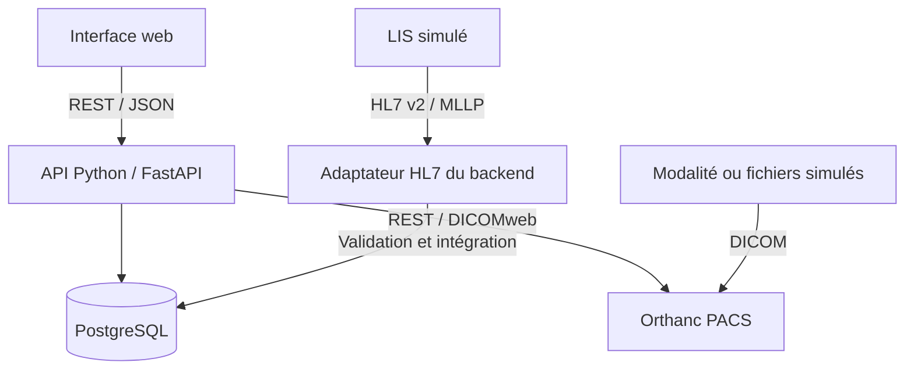

# Prototype de système de gestion de données PACS / LIS / RIS simplifié

**Mini-projet V · Santé digitale et ingénierie des systèmes de santé**

Filière INDIA · ENSAM Rabat · Année universitaire 2026–2027 · Équipe de 6 membres

Relier les résultats de laboratoire, les examens radiologiques et les images médicales autour d'un **dossier patient unique**, dans un établissement hospitalier fictif.

Ce dépôt conserve les livrables et l'évolution du projet, du cadrage à la démonstration. Le dossier [de conception](docs/conception/) contient les six documents de la semaine 1. Le squelette technique est décrit dans [ARCHITECTURE.md](ARCHITECTURE.md), et ce README sera actualisé à chaque nouvelle semaine.

## État actuel

| Repère | Situation |
| --- | --- |
| Dernière mise à jour | 5 octobre 2026 |
| Dernier jalon documenté | T02 — contrats communs proposés en revue |
| Phase actuelle | Cadrage, besoins et conception initiale |
| Livrables disponibles | Six documents PDF : cadrage, besoins, étude PACS/RIS/LIS, normes, architecture et modèle de données |
| Validation des documents | Revue et arbitrages à consigner ; leur présence ne vaut pas approbation |
| Implémentation | Squelette d'architecture, contrats, fixtures synthétiques et tests documentaires ; aucun service applicatif exécutable |
| Tests et mesures | Contrôles de schémas et d'exemples exécutés ; intégration et mesures applicatives à produire |

La contribution du **Membre 1** est décrite dans [le bilan T02](docs/T02_CONTRATS_COMMUNS.md). Elle propose les contrats communs et la répartition entre six membres ; les choix techniques attendent la revue des membres concernés. T08 sera une contribution distincte après accord sur ces interfaces.

## Objectif et périmètre

Le prototype représente un établissement disposant d'un service clinique, d'un laboratoire et d'un service de radiologie. Il doit permettre à un utilisateur autorisé de retrouver un patient fictif, d'ouvrir son épisode de soins et de consulter les informations qui lui sont correctement rattachées.

| Domaine | Rôle dans le projet |
| --- | --- |
| **LIS** — Laboratory Information System | Simuler les demandes et résultats biologiques, avec des échanges HL7 v2 |
| **RIS** — Radiology Information System | Gérer les demandes radiologiques, les examens, leurs statuts et les comptes rendus |
| **PACS** — Picture Archiving and Communication System | Archiver les objets DICOM dans Orthanc et donner accès aux études associées |
| **Dossier unifié** | Rassembler ces informations par patient et épisode, avec contrôle des accès et audit |

La v0.1 vise un parcours complet et limité : identité patient, épisode de soins, biologie, radiologie, imagerie et consultation croisée. Les acteurs principaux sont le médecin, le radiologue, le technicien de laboratoire et l'administrateur.

La facturation, la pharmacie, le portail patient, le diagnostic automatisé et le déploiement clinique réel sont hors périmètre. Les données de démonstration seront fictives et leur génération documentée. Aucune donnée réelle de patient n'est admise.

## Documentation de la semaine 1

Lire les documents dans cet ordre. Ils détaillent les hypothèses, les exigences et les décisions que les futures réalisations devront suivre ou faire évoluer explicitement.

| Document | Contenu |
| --- | --- |
| [01 — Cadrage](docs/conception/01-cadrage.pdf) | Contexte de soins, objectifs, acteurs, périmètre et critères de succès |
| [02 — Besoins et scénarios](docs/conception/02-besoins-et-scenarios.pdf) | Exigences fonctionnelles et non fonctionnelles, règles métier, scénarios et validation |
| [03 — Étude PACS / RIS / LIS](docs/conception/03-etude-pacs-ris-lis.pdf) | Étude des systèmes et de leur articulation |
| [04 — Normes et conformité](docs/conception/04-normes-et-conformite.pdf) | Standards, sécurité, confidentialité et cadre réglementaire |
| [05 — Architecture v0.1](docs/conception/05-architecture-v0.1.pdf) | Composants, interfaces, flux, déploiement envisagé et modes dégradés |
| [06 — Modèle de données v0.1](docs/conception/06-modele-donnees-v0.1.pdf) | Modèle relationnel, dictionnaire, cardinalités et contraintes d'intégrité |

## Architecture envisagée

Cette vue résume la proposition de la semaine 1 ; elle ne décrit pas encore un système déployé.



| Élément | Orientation de la semaine 1 | Statut |
| --- | --- | --- |
| Backend | Python / FastAPI pour l'intégration, les autorisations et l'audit | Choix proposé |
| Base relationnelle | PostgreSQL pour le dossier, le RIS et les traces | Choix proposé |
| Imagerie | Orthanc pour les objets DICOM ; références et métadonnées utiles en SQL | Prévu par le sujet |
| Laboratoire | LIS simulé et adaptateur HL7 v2, avec messages OML^O21 et ORU^R01 ciblés | Profil détaillé à préciser |
| Interface | Application web accédant aux données via l'API | Technologie à choisir |
| Exécution locale | Déploiement reproductible, idéalement par conteneurs | Configuration à préparer |

Le RIS reste un module logique du backend. Les pixels DICOM restent dans Orthanc. Le navigateur ne doit pas accéder directement à la base ni aux secrets d'Orthanc. Authentification, accès par rôles et journalisation sont des exigences à implémenter et à tester.

## Démonstration et validation prévues

**Scénario nominal :** le patient fictif `PAT-SIM-0007`, pendant l'épisode `ENC-2026-0091`, bénéficie d'une NFS, d'une CRP et d'un scanner thoracique. Le prototype devra relier les résultats HL7 v2, le compte rendu radiologique et l'étude DICOM, puis afficher le dossier unifié et tracer sa consultation.

Ce scénario est celui des PDF. Pour le premier essai technique, le starter et T02 utilisent **DEMO-001 : CRP/glucose**, avec d'autres identifiants. L'écart est explicite dans [D19](docs/DECISIONS.md) et [le contrat d'identifiants](contracts/identifiants.md) ; il doit être accepté ou résolu avant la démonstration finale.

**Cas dégradé prioritaire :** la valeur CRP est absente ou inexploitable. Les autres informations restent consultables et l'absence est explicitement signalée. Une valeur manquante ne doit jamais être remplacée par zéro.

| Indicateur | Cible initiale issue des besoins | Résultat actuel |
| --- | --- | --- |
| Temps de réponse du dossier, p95 | Moins de 1 s sur 30 lectures après échauffement | Non mesuré |
| Délai d'intégration HL7 nominal | Moins de 2 s entre réception et persistance | Non mesuré |
| Complétude du dossier | 100 % en nominal ; défaut visible en dégradé | Non mesurée |
| Accès refusés journalisés | 100 % des cas testés | Non testé |
| Réussite du scénario complet | 5 répétitions réussies sur 5 | Non testé |

Les cibles seront évaluées dans un environnement local documenté. La sécurité, le consentement, la confidentialité et la loi marocaine 09-08 font partie du travail prévu ; aucune conformité certifiée n'est revendiquée.

## Suivi hebdomadaire du cycle de vie

Le parcours prévu est : **cadrage → exigences → conception → réalisation → validation → démonstration et bilan**. Une décision peut être revue à partir des essais ; sa justification et son historique doivent rester consultables.

| Semaine | Phase et travail documenté | Livrables / preuves | État et suite |
| --- | --- | --- | --- |
| 1 | Cadrage, besoins, étude des systèmes, normes, architecture et modèle initial | [Six PDF de référence](docs/conception/) | Documents déposés ; squelette technique ajouté ; revue et arbitrages à poursuivre |
| Jalon T02 — 05/10/2026 | Contrats, scénario commun et responsabilités | [Bilan de contribution](docs/T02_CONTRATS_COMMUNS.md) | Proposition du Membre 1 ; revue collective en attente |

### Mettre à jour ce README chaque semaine

1. Ajouter les nouveaux livrables dans un dossier documentaire adapté, en conservant les versions antérieures.
2. Ajouter une ligne au tableau avec les travaux réellement effectués et des liens vers leurs preuves : documents, code, revues ou résultats de tests.
3. Actualiser **État actuel**, les choix d'architecture et les prochaines étapes. Distinguer systématiquement ce qui est proposé, réalisé, testé et validé.
4. Consigner les changements de décision, leur motif, les contributions et les points non résolus dans le bilan de la semaine.
5. Faire relire la mise à jour par un autre membre avant de l'intégrer au dépôt.

Modèle à copier dans le bilan de chaque nouvelle semaine :

```markdown
## Semaine N — [dates]

- Objectif :
- Travaux réalisés :
- Livrables et preuves :
- Décisions prises ou modifiées, avec justification :
- Tests / mesures effectués et résultats :
- Contributions : [membre — travail — lien]
- Relecture : [membre — date — remarques]
- Difficultés et questions ouvertes :
- Prochaines actions : [action — responsable — échéance]
```

## Prochaines étapes à convenir en équipe

- Relire les six livrables et consigner les arbitrages sur les identifiants, le profil HL7, l'accès aux images et la conservation des traces.
- Répartir les responsabilités entre les six membres et fixer les échéances.
- Confirmer les choix techniques proposés et préparer un environnement local commun.
- Préparer les données fictives et une première réalisation limitée au scénario documenté.

## Architecture et démarrage technique

Le dépôt contient maintenant le squelette général qui guidera l'implémentation : backend modulaire FastAPI, PostgreSQL, Orthanc, contrats API/HL7/DICOM, simulateurs, fixtures synthétiques, backlog, règles de contribution, sécurité et contrôles de contrat. Consultez [le backlog](docs/BACKLOG.md) et [le guide de démarrage](docs/DEMARRAGE.md) avant de créer du code applicatif.

Le squelette est volontairement documentaire. Les choix encore ouverts sont listés dans [les décisions](docs/DECISIONS.md), notamment le frontend, l'authentification détaillée, le profil HL7 et les versions exactes des outils.

## Installation et exécution

Le dépôt contient actuellement la documentation initiale. Les dépendances, configurations et commandes d'installation seront ajoutées avec le premier incrément exécutable, puis vérifiées sur un second poste. Aucun lancement d'application n'est disponible à ce stade.
