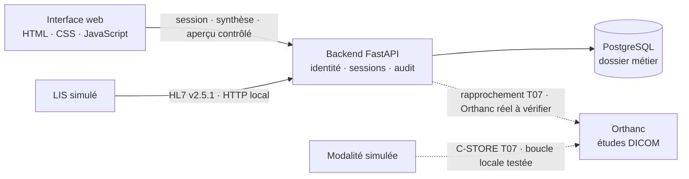

<h1 align="center">🩺 PACS · LIS · RIS</h1>

<p align="center">
  <strong>Un dossier patient unifié, construit avec des données 100 % fictives.</strong><br>
  Mini-projet V · Santé digitale et ingénierie des systèmes de santé · ENSAM Rabat
</p>

<p align="center">
  
  
  <a href="https://github.com/Bouch-Anass/Prototype-de-syst-me-de-gestion-de-donn-es-PACS-LIS-RIS-simplifi-/actions/workflows/check-architecture.yml">
    
  </a>
</p>

<p align="center">
  
  
  
  
  
  
</p>

<p align="center">
  <a href="#aperçu">Aperçu</a> · <a href="#démarrage-rapide">Démarrage rapide</a> ·
  <a href="#architecture">Architecture</a> · <a href="#feuille-de-route">Feuille de route</a> ·
  <a href="#documentation">Documentation</a>
</p>

> [!IMPORTANT]
> Prototype pédagogique pour un établissement fictif. Aucune donnée réelle de patient ni utilisation diagnostique ou clinique.

## Aperçu

Le projet relie **biologie (LIS)**, **radiologie (RIS)** et **imagerie (PACS)** autour d'un patient et d'une rencontre. Le parcours cible part d'une demande, intègre les résultats et les études, puis compose un dossier consultable par un utilisateur autorisé.

La v0.1 se limite à un parcours synthétique pour le médecin, le radiologue, le technicien de laboratoire et l'administrateur. Facturation, pharmacie, portail patient et diagnostic automatisé sont hors périmètre. Les obligations de confidentialité, notamment la loi marocaine 09-08, restent à étudier ; aucune conformité certifiée n'est revendiquée.

| Ce qui se visite ou se teste aujourd'hui | État |
| --- | --- |
| [Interface web](frontend/README.md) : mocks et mode API locale | Recherche, connexion, synthèse et aperçu PNG contrôlé ; mode API testé contre SQLite et un faux Orthanc |
| [Backend FastAPI](backend/README.md) : session, identité, audit, laboratoire, HL7, RIS, synthèse et imagerie | Tests SQLite et PostgreSQL 18 local ; consultation Docker PostgreSQL 17 et aperçu Orthanc réel vérifiés |
| [Environnement local](infra/README.md) : PostgreSQL et Orthanc dans Docker Compose | Application, PostgreSQL et Orthanc sains ; consultation et aperçu vérifiés sur les données existantes |
| [Contrats](contracts/README.md) HL7 v2.5.1, API et imagerie | Profil HL7 branché au laboratoire ; workflows RIS et rapprochement PACS internes testés |

## Démarrage rapide

**Lancer l'application avec Docker :** sur une installation dont les comptes et le scénario sont déjà préparés, lancer `python3 scripts/init_local_env.py`, puis `docker compose -f infra/compose.yaml up -d --build`. Ouvrir **http://127.0.0.1:8000/frontend/** et choisir **API locale**. Le [guide infrastructure](infra/README.md) décrit aussi Compose V1 ; le [guide de démonstration](docs/DEMO.md) couvre l'initialisation d'un clone vierge.

**Validation du 10 novembre 2026 :** application, PostgreSQL et Orthanc sains ; connexion, recherche, synthèse et aperçu PNG vérifiés sur les données existantes. Lire le [problème et la correction Docker](docs/DOCKER_FIX.md) et les [suggestions de présentation](docs/DEMO_SUGGESTIONS.md). Cette vérification ne clôt pas l'initialisation depuis une base vierge, les ingestions ni les mesures de performance.

**Voir l'interface sans installer de dépendances :** depuis la racine du dépôt, lancez un serveur HTTP local.

```bash
python3 -m http.server 8000 --bind 127.0.0.1
```

Ouvrez **http://127.0.0.1:8000/frontend/** et recherchez `DEMO-P001`. Sous Windows, remplacez `python3` par `py`. L'aperçu utilise les mocks du dépôt ; il ne demande ni PostgreSQL ni Orthanc.

**Essayer le parcours API local :** suivez la [démonstration reproductible](docs/DEMO.md) pour initialiser PostgreSQL et Orthanc, ingérer les données fictives et ouvrir le mode **API locale** de l'interface.

## Architecture



Les traits pointillés indiquent les ingestions et rapprochements restant à rejouer avec les services Docker ; la lecture d’une étude existante et son aperçu ont été vérifiés avec Orthanc réel. Le flux HL7 est testé sur SQLite et PostgreSQL 18 local ; le parcours Compose PostgreSQL 17 reste à vérifier. Le simulateur DICOM a été testé par C-STORE en boucle locale, et le rapprochement avec un faux Orthanc. Les pixels DICOM restent dans Orthanc dans l'architecture cible ; les données métier et les traces résident dans PostgreSQL. Le navigateur ne reçoit ni accès direct à la base ni identifiants d'administration Orthanc. L'[architecture détaillée](ARCHITECTURE.md) décrit les frontières et les modes dégradés.

### Stack et état réel

| Couche | Technologie | Situation |
| --- | --- | --- |
| API | Python, FastAPI, SQLAlchemy, Alembic | T03–T08 et routes d'imagerie T10 implémentés ; tests SQLite avec doubles Orthanc |
| Données métier | PostgreSQL 17 cible | PostgreSQL 17 actif dans Docker ; consultation vérifiée. Concurrence et persistance vérifiées séparément sur PostgreSQL 18 local |
| PACS | Orthanc | Orthanc actif dans Docker ; aperçu PNG réel vérifié sur une étude existante ; nouvelle ingestion à vérifier |
| Interface | HTML, CSS, JavaScript | Mocks et mode API locale ; parcours navigateur réel à vérifier |
| Échanges | HL7 v2.5.1, DICOM | HL7 testé sur SQLite ; génération DICOM et C-STORE de boucle locale testés |

## Scénario synthétique

Le [manifeste commun](data/fixtures/scenario.json) suit le patient `DEMO-P001` pendant la rencontre `DEMO-E001` : une CRP, une mesure de glucose et un examen CT. La variante dégradée garde le glucose visible quand la CRP manque ; **une valeur absente n'est jamais transformée en zéro**. Les [trois réponses de référence](contracts/examples/README.md) couvrent le cas nominal, la CRP manquante et l'indisponibilité d'Orthanc.

## Vérifications

Le bilan automatisé antérieur comprend : **17 tests de contrat**, **46 tests backend sur SQLite**, **1 test intégré sur PostgreSQL 18 local**, **1 test DICOM/C-STORE en boucle locale** lors du jalon T07, contrôle des liens et migrations Alembic. La concurrence et la persistance ont été vérifiées sur PostgreSQL 18. Le 10 novembre, la consultation Docker avec PostgreSQL 17 et l’aperçu Orthanc réel ont réussi ; le navigateur et l’initialisation complète restent à valider. Voir les [preuves et limites](docs/VERIFICATIONS.md).

```bash
python3 scripts/check_repo.py
python3 -m unittest discover -s tests/contract -v
# Après installation de backend/requirements-dev.txt :
python3 -m unittest discover -s tests/backend -v
# Après installation de simulators/modality/requirements.txt :
python3 -m unittest discover -s tests/modality -v
```

<details>
<summary>Objectifs de validation du scénario complet</summary>

| Indicateur | Cible initiale | Mesure actuelle |
| --- | --- | --- |
| Temps de réponse du dossier, p95 | Moins de 1 s sur 30 lectures après échauffement | 0,058 s sur PostgreSQL 18 local avec faux Orthanc ; stack Docker non mesurée |
| Délai d'intégration HL7 nominal | Moins de 2 s entre réception et persistance | Non mesuré |
| Complétude du dossier | 100 % en nominal ; défaut visible en dégradé | Non mesurée |
| Accès refusés journalisés | 100 % des cas testés | Test T03 ciblé ; scénario global non testé |
| Scénario complet | 5 répétitions réussies sur 5 | Non testé |

</details>

## Feuille de route

- [x] **T01/T02 — préparation :** Compose local, contrats, profil HL7, fixtures et aperçu web.
- [x] **T03 — première tranche :** migration, identité synthétique, sessions, accès par rencontre et audit.
- [x] **Validation PostgreSQL 18 locale :** migration, contrôle de schéma, concurrence et persistance du cluster temporaire.
- [ ] **Validation Compose PostgreSQL 17 :** démarrage depuis un clone et persistance des volumes Docker.
- [x] **T04 — service laboratoire :** demandes, résultats, valeurs manquantes, rejeux et corrections testés sur SQLite.
- [x] **T05 — première tranche HL7 :** endpoint interne, profil local, ACK, rejeu et corrections testés sur SQLite.
- [x] **T05 — concurrence :** rejeux HL7 simultanés testés sur PostgreSQL 18 local.
- [ ] **T05 — validation restante :** parcours Docker PostgreSQL 17.
- [x] **T06 — première tranche :** service interne RIS, transitions et validation réservée au radiologue testés sur SQLite.
- [x] **T06 — routes HTTP :** création, réalisation, brouillon et validation avec session et CSRF testés sur SQLite.
- [x] **T06 — concurrence :** accession, réalisation et validation simultanées testées sur PostgreSQL 18 local.
- [ ] **T06 — validation restante :** parcours Docker PostgreSQL 17.
- [x] **T07 — première tranche :** DICOM synthétique, C-STORE de boucle locale et rapprochement Orthanc interne testés.
- [x] **T07 — concurrence :** rattachement simultané testé sur PostgreSQL 18 avec faux Orthanc.
- [ ] **T07 — validation restante :** import Orthanc Docker et parcours PostgreSQL 17.
- [x] **T08–T11 — première tranche :** synthèse clinique, mode API du frontend, aperçu PNG contrôlé et parcours intégré testés sur SQLite avec faux Orthanc.
- [ ] **T08–T11 — validation restante :** performance, navigateur réel, Docker et répétitions du parcours complet.
- [x] **T12 — procédure :** guide et script de vérification locale publiés.
- [ ] **T12 — clôture :** exécution depuis un clone vierge avec Docker et bilan mesuré.

Le [backlog détaillé](docs/BACKLOG.md) donne les critères d'acceptation de chaque étape. Les décisions encore ouvertes sont suivies dans [docs/DECISIONS.md](docs/DECISIONS.md).

## Documentation

| Lire | Pour |
| --- | --- |
| [Démonstration](docs/DEMO.md) · [Backend](backend/README.md) · [Infrastructure](infra/README.md) | Installer et exécuter le parcours local |
| [Architecture](ARCHITECTURE.md) · [Modèle de données](docs/MODELE_DONNEES.md) | Comprendre les composants et les invariants |
| [Contrats API, HL7 et imagerie](contracts/README.md) · [Fixtures](data/README.md) | Développer les domaines sur des exemples communs |
| [Design](DESIGN.md) · [Interface frontend](frontend/README.md) | Comprendre les modes mocks et API |
| [Contribuer](CONTRIBUTING.md) · [Sécurité](SECURITY.md) · [Répartition](docs/REPARTITION_TRAVAIL.md) | Participer sans mélanger les responsabilités |
| [Conception initiale](docs/conception/) · [Vérifications](docs/VERIFICATIONS.md) | Retrouver les six PDF et les preuves d'essai |

<details>
<summary>Historique du projet</summary>

| Jalon | Livrables | État |
| --- | --- | --- |
| Semaine 1 | Six PDF : cadrage, besoins, étude PACS/RIS/LIS, normes, architecture et modèle de données | Documents déposés ; revue d'équipe à poursuivre |
| T01/T02 · 13 octobre 2026 | Compose, profil HL7, jeu synthétique et aperçu web | 17 tests de contrat réussis ; Docker non vérifié |
| T03 · 19 octobre 2026 | Backend identité, droits et audit | 9 tests SQLite et contrôle de migration réussis ; PostgreSQL non vérifié |
| T04 · 21 octobre 2026 | Service laboratoire et migration des domaines | 6 nouveaux tests SQLite réussis ; adaptateur HL7 et PostgreSQL non vérifiés |
| T05 · 21 octobre 2026 | Réception HTTP HL7 et émetteur de fixtures | 6 nouveaux tests SQLite réussis ; concurrence et PostgreSQL non vérifiés |
| T07 · 21 octobre 2026 | DICOM synthétique et rapprochement Orthanc interne | 12 nouveaux tests SQLite et 1 test C-STORE de boucle locale ; Orthanc Docker et PostgreSQL non vérifiés |
| T06 · 21 octobre 2026 | Workflow RIS et compte rendu final internes | 5 nouveaux tests SQLite réussis ; routes HTTP, concurrence et PostgreSQL non vérifiés |

La filière INDIA de l'ENSAM Rabat mène ce mini-projet en équipe de six membres pendant l'année universitaire 2026–2027. Le suivi hebdomadaire doit distinguer ce qui est **proposé, implémenté, testé et validé** ; les [modèles de travail](docs/03-working-templates.md) et les [documents de conception](docs/conception/) restent les références de départ.

</details>

## Contribuer

Consultez les [conventions de contribution](CONTRIBUTING.md), les [frontières de travail](docs/REPARTITION_TRAVAIL.md) et les [règles de sécurité](SECURITY.md) avant une modification. Le projet n'admet aucune donnée réelle de patient dans le dépôt.
