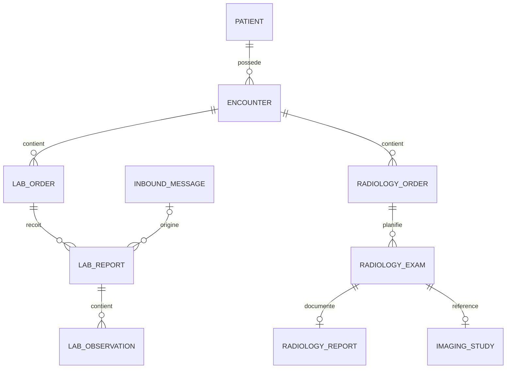

# Modèle de données d'implémentation

Ce modèle reprend les entités du document de conception. La migration T03 crée patient, rencontre, utilisateurs, rôles, accès, sessions et audit avec leurs premières contraintes. La migration `0002_domains` ajoute les tables des lots B et C ; `0003_imaging_role` ajoute le rôle du technicien d'imagerie. Les services laboratoire, RIS et imagerie sont implémentés. Les UUID sont les identifiants internes ; les identifiants externes ne les remplacent pas.

## Vue relationnelle principale

Une entité peut n'avoir aucun enfant lors de sa création. Un rapport biologique appartient à une seule demande. Une observation appartient à une seule version du rapport. Un examen peut exister avant son compte rendu ou son étude.

## Tables métier

| Table | Champs principaux | Contraintes essentielles | Lot |
|---|---|---|---|
| `patient` | id, external_id, identifier_domain, noms, birth_date, sex, is_synthetic, created_at | Couple domaine/identifiant unique ; données de démonstration synthétiques | A |
| `encounter` | id, patient_id, external_id, type, status, started_at, ended_at | Patient obligatoire ; fin non antérieure au début | A |
| `lab_order` | id, encounter_id, placer_number, filler_number, ordered_at, status | Rencontre obligatoire ; origine des numéros explicite | B |
| `lab_report` | id, lab_order_id, inbound_message_id, reported_at, status, version | Version positive ; unicité proposée sur demande/version | B |
| `lab_observation` | id, lab_report_id, coding_system, code, display, value_numeric, value_text, unit, data_status | Valeur absente distincte de zéro ; couple système/code unique par version de rapport | B |
| `radiology_order` | id, encounter_id, accession_number, requested_procedure, priority, status | Accession unique dans le périmètre initial à source unique | C |
| `radiology_exam` | id, order_id, modality, performed_at, status | Date requise si examen réalisé | C |
| `radiology_report` | id, exam_id, author_user_id, content, status, validated_at | Au plus un compte rendu courant par examen ; validation datée | C |
| `imaging_study` | id, exam_id, study_instance_uid, orthanc_study_id, modality, series_count, instance_count, availability_status, last_synced_at | Examen unique ; Study Instance UID unique ; nombres non négatifs | C |

Le compte rendu radiologique est un document courant avec états `draft/final/amended`. Une conservation structurée de toutes ses versions nécessiterait une table complémentaire, à décider avant de revendiquer cet historique. Le journal d'audit ne remplace pas l'archivage du texte des versions.

## Tables transversales

| Table | Champs ou relations | Règles |
|---|---|---|
| `inbound_message` | id, source_system, external_message_id, message_type, received_at, processing_status, payload_hash, error_code | Unicité du couple source/identifiant ; pas de payload clinique dans les logs |
| `app_user` | id, username, hash scrypt, état actif et blocage temporaire | Aucun mot de passe en clair ; cinq échecs entraînent un blocage de 15 minutes |
| `role`, `user_role` | Rôles et association utilisateurs/rôles | Attribution explicite ; droits évalués côté serveur |
| `user_encounter_access` | utilisateur et rencontre autorisée | Le rôle seul ne confère pas de contexte clinique |
| `app_session` | hash du jeton et du jeton CSRF, utilisateur, dates d'activité et d'expiration | Session opaque, 30 minutes d'inactivité et 8 heures maximum |
| `audit_event` | id, actor_user_id, action, resource_type, resource_id, outcome, correlation_id, occurred_at, client_ip facultative | Acteur nullable pour un processus système identifié ; données minimales |

Ces tables transversales sont livrées par la migration T03. Les migrations, les accès par rôle et les parcours concurrents ont été vérifiés sur PostgreSQL ; la persistance des volumes Docker après redémarrage reste à mesurer.

La saisie manuelle du laboratoire accepte jusqu'à 200 observations par version de rapport, dont des codes locaux supplémentaires. Un même code ne peut apparaître qu'une fois dans une version ; une mesure corrigée crée une nouvelle version. Le profil HL7 de démonstration reste limité aux analyses attendues par le manifeste. Le multi-import DICOM n'ajoute pas une table par fichier : Orthanc stocke les instances, tandis que `imaging_study` conserve la référence de l'étude et les compteurs synchronisés.

## Invariants

1. Toutes les relations métier utilisent des clés étrangères.
2. Une valeur biologique `available` porte exactement une valeur numérique ou textuelle.
3. Une valeur `missing` ne porte aucune valeur ; une valeur `invalid` ne devient pas une valeur affichable.
4. Une correction biologique crée une nouvelle version, sans mise à jour destructrice de l'ancienne.
5. Une date de validation est obligatoire pour un compte rendu final.
6. Une étude ne peut pas être rapprochée si le patient et l'accession se contredisent.
7. Aucune suppression en cascade de tout un dossier n'est ajoutée par défaut.
8. Les nombres de séries/instances connus ne prouvent la complétude que comparés à une attente définie.
9. Tous les instants applicatifs exposés par l'API utilisent ISO 8601 avec fuseau ; le stockage normalise les instants.
10. Les codes locaux de démonstration ne sont pas présentés comme des codes LOINC validés.

## Idempotence

`UNIQUE(source_system, external_message_id)` protège contre les collisions entre émetteurs et contre les doublons au sein d'un émetteur. Le hash du contenu distingue une retransmission identique d'une réutilisation incohérente d'identifiant.

Un message déjà traité ne repasse pas à l'état `duplicate` au prix de perdre son état de réussite : le statut de réception canonique et la trace des nouvelles tentatives doivent être distingués. La proposition initiale est de conserver la ligne traitée et de tracer le rejeu dans l'audit. Si un historique technique détaillé est nécessaire, une table de tentatives pourra être ajoutée.

Les messages rejetés doivent laisser une trace technique minimale après le rollback des écritures métier. Le choix des transactions doit rendre cela possible.

## Propriété des migrations

Le lot A organise l'historique commun. B et C écrivent les migrations de leurs tables ; elles sont intégrées dans un ordre unique. Une migration déjà appliquée n'est pas modifiée en place : une migration suivante corrige le schéma.

## Extensions différées

Prélèvements, items de demande, terminologies normalisées complètes, institutions multiples et archivage de versions radiologiques sont des évolutions possibles. Le premier scénario utilise un manifeste d'analyses attendues pour reconnaître une CRP manquante ; il ne prétend pas disposer d'un catalogue LIS complet.

