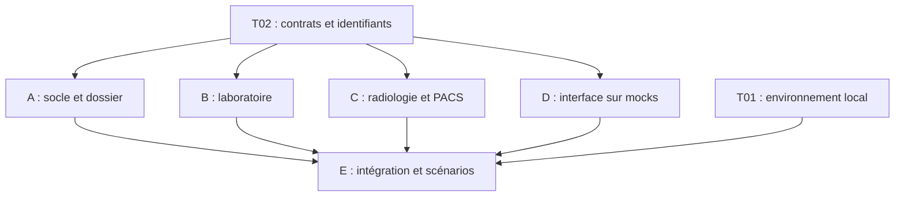

# Répartition du travail

Répartition retenue le 5 octobre 2026 pour six membres. Le porteur de cette contribution est le **Membre 1**. Les lettres A à E désignent des domaines techniques historiques, et non des personnes. Chaque membre écrit les tests et la documentation de son périmètre et corrige ses défauts d'intégration.

## Responsables et revues

| Membre | Responsabilité | Tâches | Première livraison | Revue attendue |
|---|---|---|---|---|
| 1 | Contrats et dossier unifié | T02, T08 | Contrats, scénario commun, puis composition du dossier | Membres 2 à 6 pour leur interface |
| 2 | Backend et sécurité | T03, autorisation de T10 | Identité, sessions, permissions, audit, migrations communes | 1 et 6 |
| 3 | Laboratoire et HL7 | T04, T05 | Domaine laboratoire, adaptateur et simulateur LIS | 1 et 2 |
| 4 | Radiologie et imagerie | T06, T07, backend de T10 hors autorisation | RIS, rapprochement et récupération Orthanc | 1, 2 et 5 |
| 5 | Interface et affichage des images | T09, frontend de T10 | Interface sur exemples puis API, viewer, tests d'interface | 1 et 4 |
| 6 | Environnement et intégration | T01, support T02, coordination T11/T12 | Environnement, automatisation et jeux de test reproductibles | Responsables des domaines concernés |

Le Membre 1 possède le manifeste de référence ; le Membre 6 aide à préparer les variantes de test. Le Membre 3 produit les messages HL7 et le Membre 4 les objets DICOM. Le Membre 4 coordonne T10 : il applique côté serveur les autorisations fournies par le Membre 2 avant toute récupération d'image ; le Membre 5 intègre cet accès à l'interface.

T08 compose les services des Membres 2, 3 et 4. Il ne réimplémente ni leur autorisation ni leurs règles métier. Une revue par les consommateurs précède toute modification incompatible d'un contrat. T11 et T12 sont collectifs ; leur coordination ne transfère pas tous les tests et tout le rapport au Membre 6.

## Lots

| Lot | Périmètre principal | Entrées | Livrable vérifiable |
|---|---|---|---|
| A : socle et dossier | Backend commun, identité, auth, audit, synthèse, migrations communes | Identifiants et contrats | Recherche patient, consultation autorisée, audit et réponse de synthèse |
| B : laboratoire et HL7 | Domaine laboratoire, adaptateur HL7, simulateur LIS | Patient et rencontre du jeu commun | OML/ORU traités, ACK cohérent, résultats versionnés et rejouabilité |
| C : radiologie et PACS | RIS, imagerie, client Orthanc, simulateur de modalité | Patient, rencontre et accession | Étude rattachée sans ambiguïté, compte rendu, état d'imagerie |
| D : interface web | Recherche, dossier, biologie, radiologie, états dégradés | Contrat API et exemples JSON | Écrans utilisables avec mocks, puis API réelle |
| E : environnement et validation | Environnement local, CI, scénarios de bout en bout | Contrats et critères de chaque lot | Démarrage reproductible, tests nominaux et dégradés |

## Frontières de fichiers

| Lot | Dossiers principalement modifiés |
|---|---|
| A | `backend/src/app/core/`, `backend/src/app/db/`, `backend/src/app/modules/identity/`, `auth/`, `audit/`, `summary/` |
| B | `backend/src/app/modules/laboratory/`, `backend/src/app/integrations/hl7/`, `simulators/lis/`, `data/hl7/` |
| C | `backend/src/app/modules/radiology/`, `imaging/`, `backend/src/app/integrations/orthanc/`, `simulators/modality/`, `data/dicom/` |
| D | `frontend/` |
| E | `infra/`, `.github/workflows/`, `tests/integration/`, `tests/e2e/`, `scripts/` |

Les chemins abrégés `auth/`, `audit/`, `summary/` et `imaging/` sont relatifs à `backend/src/app/modules/`.

Les contrats, le manifeste synthétique et le modèle de données sont partagés. Le lot A coordonne leur cohérence ; un changement nécessite la revue des consommateurs concernés. Chaque lot reste responsable des tests unitaires de son propre code.

## Dépendances concrètes

Le lot E prépare l'environnement et les tests dès le début. Il ne commence pas seulement à la fin. Le frontend peut avancer sans API grâce aux exemples de réponse, tandis que les lots B et C utilisent le même manifeste synthétique.

## Contrats à stabiliser en premier

| Point commun | Décision attendue |
|---|---|
| Identité | UUID interne, domaine externe, PatientID DICOM et identifiant PID cohérents |
| Rencontre | Même rencontre pour les parcours de démonstration |
| API | Chemins, champs, états, codes d'erreur et règles d'accès |
| HL7 | Version précise, profil OML/ORU, mode d'ACK et premier transport |
| Imagerie | Accession, Study Instance UID, rapprochement et consultation contrôlée |
| Migrations | Un historique ordonné, sans deux migrations concurrentes portant le même identifiant |
| Frontend | Framework et gestion d'authentification explicitement décidés |

## Critères de fin par lot

### A : socle

- Un patient peut être recherché par identifiant exact.
- Un rôle interdit renvoie 403 ; un dossier inexistant ou hors affectation renvoie 404 sans données sensibles.
- La synthèse compose des services, sans requêtes métier dispersées dans la route.
- Les créations et lectures sensibles sont auditées.
- Les migrations sont reproductibles sur une base vide.

### B : laboratoire

- Une demande puis un résultat du simulateur sont rattachés à la bonne rencontre.
- Un message valide n'est acquitté positivement qu'après le commit.
- Le rejeu exact ne crée aucune donnée métier supplémentaire.
- Une correction crée une version supplémentaire, sans écraser l'historique.
- Une CRP absente ne supprime pas les observations présentes.

### C : radiologie et PACS

- La demande, l'examen, le compte rendu et l'étude restent des objets distincts.
- Une étude est rapprochée par identifiants contrôlés.
- Un mauvais patient ou une accession inconnue empêche le rattachement automatique.
- Une panne Orthanc produit un état dégradé explicite.
- La consultation d'une image vérifie à nouveau les droits.

### D : interface

- Les trois exemples JSON sont affichés sans changement manuel du code.
- Une valeur absente est rendue par « Résultat manquant », jamais par zéro.
- Les erreurs, chargements et refus d'accès ont des affichages distincts.
- Aucun secret Orthanc n'apparaît dans le navigateur.

### E : environnement et validation

- Les commandes de lancement sont reproductibles depuis un clone vierge.
- Les ports exposés et les volumes persistants sont explicités.
- Les tests nominaux, rejoués, refusés et dégradés sont automatisés progressivement.
- Une CI verte distingue contrôles documentaires et tests applicatifs.
- Les résultats d'essai sont reproductibles avec les seuls jeux synthétiques.

## Ordre de réalisation

| Étape | Résultat attendu |
|---|---|
| 1. Accord sur les contrats | Identifiants, réponses et profil d'échange figés pour le premier jalon |
| 2. Travail indépendant | Services métier minimaux, écran sur mocks, simulateurs et environnement |
| 3. Intégration verticale | Un seul patient traverse tout le parcours |
| 4. Robustesse | CRP absente, PACS arrêté, doublon HL7, mauvais identifiant, accès interdit |
| 5. Démonstration | Recréation du parcours depuis un environnement propre |

Le point de contrôle utile est : « quelle donnée traverse déjà deux modules et peut être vérifiée ? » Il aide à repérer une intégration réellement en progrès.

